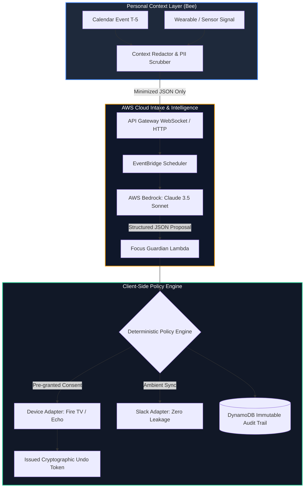

# Project AURA — Proactive Memory That Fights For Your Focus

<div align="center">

[](https://aws.amazon.com/bedrock/)
[](#aws-cloud-architecture-11-services)
[](https://www.python.org/)
[](https://vercel.com/)
[](tests/)
[](LICENSE)
[](SECURITY_REVIEW_CERTIFICATION.md)

**Bee remembers what you forgot. Aura remembers what you're about to forget, and stops the world from distracting you.**

[🌐 Live Web Application](#live-web-application) • [🏗️ Architecture](#system-architecture) • [☁️ AWS Cloud Architecture (11 Services)](#aws-cloud-architecture-11-services) • [🛡️ Zero-Surveillance Guarantee](#zero-surveillance-guarantee) • [🤖 IBM Bob Modernization](#ibm-bob-modernization)

</div>

---

## 🌟 Overview: What Makes AURA Different

Most meeting-memory products optimize the loop **record → transcribe → summarize after**.  
**AURA operates BEFORE the meeting**, then **acts through consented adapters** to defend your focus session.

Built as a privacy-first layer: Bee remains the local personal-memory source; AURA receives only purpose-bound, minimized context and never stores raw audio.

* **BEFORE not AFTER:** Calibrates context 5 minutes ahead of meetings ($T-5$) with evidence-grounded insights.
* **ACTS via Connected Devices:** Intelligently pauses allowed distractions (Fire TV, Echo DND) via verified capability paths.
* **100% Cryptographic Reversibility:** Every single action issued by the agent is bound to a 1-click **Undo Token**.
* **Zero-Surveillance Guarantee:** Strictly client-side minimization. Zero raw audio or unredacted transcripts ever touch the cloud. No employer leaderboards or surveillance.

---

## 🚀 Live Web Application & Local Runtime

### 1. Web Control Plane (Live on Vercel)
A mobile-first, zero-dependency control plane dashboard:
* **Landing Page:** Interactive architectural breakdowns, hardware reference specifications, and threat model attestations.
* **Control Plane Dashboard:** Real-time pre-meeting brief evaluation, focus session timer, reversible device pause simulation, consent grant management, and immutable audit timeline.

### 2. Local Companion Runtime & Automated Test Suite
To run the automated end-to-end companion lifecycle locally:
```bash
python -m standalone_agent.live_demo --auto
```
*Executes the complete 6-stage lifecycle: Pre-meeting brief → Distraction signal → Policy evaluation → Reversible pause with Undo → Zero-leakage Slack sync → Multi-provider resilience.*

### 3. AWS Bedrock Verification Utility
Verify live AWS credentials, IAM STS identity, and Amazon Bedrock models:
```bash
python test_aws_bedrock.py
```

---

## ☁️ AWS Cloud Architecture (11 Services)

Project AURA is designed and deployed using **AWS Cloud Development Kit (CDK v2)** in TypeScript (`infra/lib/aura-cloud-intake-stack.ts`), orchestrating **11 enterprise AWS services**:

| # | AWS Service | Role in Architecture |
|---|---|---|
| **1** | **Amazon Bedrock** | Generates pre-meeting briefing summaries and three preparation questions using **Anthropic Claude 3.5 Sonnet** via the Bedrock Converse API with strict Pydantic JSON schemas and prompt-injection defenses. |
| **2** | **AWS Lambda** | Executes serverless event handlers: `focus_guardian` (T-5 meeting intelligence & distraction evaluation), `websocket_handler` (connection state & outbox relay), and `control_plane` (consent grants, session states, and audit trails). |
| **3** | **Amazon DynamoDB** | Single-table database (`AuraCoreTable` & `AuraWebSocketConnections`) storing context snippets, audit records, and active WebSocket connection IDs with automated **30-day Time-To-Live (TTL)** and Point-in-Time Recovery (PITR). |
| **4** | **Amazon EventBridge** | Custom event bus (`aura-event-bus`) orchestrating T-5 meeting prep triggers, focus signal routing, and compliant event archiving with 30-day retention. |
| **5** | **Amazon API Gateway (HTTP v2)** | REST control plane API exposing `/api/v1/focus/signal`, `/api/v1/consent/grants`, `/api/v1/actions/undo`, and `/api/v1/audit/actions`. |
| **6** | **Amazon API Gateway (WebSocket v2)** | Low-latency bi-directional ingress gateway for real-time local companion sensor signal streaming (`$connect`, `$disconnect`, `relay`). |
| **7** | **Amazon SQS** | Decoupled asynchronous event buffering queues (`aura-intake-queue`) and Dead Letter Queues (DLQs: `aura-intake-dlq`, `aura-eventbridge-dlq`) with automated 3x retry policies. |
| **8** | **AWS KMS (Key Management Service)** | Customer Managed Encryption Key (CMK `alias/aura-kms-key`) with automated rotation, encrypting all data at rest across DynamoDB tables, queues, and Lambdas. |
| **9** | **AWS WAF (Web Application Firewall)** | Regional Web ACL protecting API Gateway endpoints with `AWSManagedRulesCommonRuleSet`, `KnownBadInputsRuleSet`, and IP rate limiting (500 requests / 5 minutes). |
| **10** | **AWS Secrets Manager** | Secure storage and automated rotation of external integration credentials (Slack OAuth PKCE credentials, Alexa capability tokens) with zero hardcoded keys. |
| **11** | **AWS IAM (Identity & Access Management)** | Enforces least-privilege execution roles for Lambda functions and resource-scoped policy statements for Amazon Bedrock `InvokeModel` access. |
| *—* | *AWS CloudWatch & CDK v2* | Structured JSON logging, metrics, and Infrastructure-as-Code definitions. |

---

## 🏗️ System Architecture



Detailed architectural contracts, data models, and sequence flows are documented in:
* [`ARCHITECTURE.md`](ARCHITECTURE.md) — Comprehensive technical architecture
* [`PRD.md`](PRD.md) — Product requirements document & UX specification
* [`IMPLEMENTATION.md`](IMPLEMENTATION.md) — Module-by-module implementation plan
* [`RUNBOOKS.md`](RUNBOOKS.md) — Disaster recovery, circuit breakers, and operational runbooks

---

## 🛡️ Zero-Surveillance Guarantee

1. **Client-Side Minimization First:** Raw audio and private transcripts never leave the user's personal device.
2. **Ephemeral Context (TTL):** Cloud intake context expires automatically via DynamoDB TTL within 30 days.
3. **No Surveillance Metrics:** Strictly zero employee ranking, manager dashboards, or workplace productivity tracking.
4. **Deterministic Gatekeeper:** The LLM only proposes recommendations (`policy_required: true`); the standalone policy engine is the sole execution gate.

Detailed compliance, DPIA, and SBOM are certified in [`SECURITY_REVIEW_CERTIFICATION.md`](SECURITY_REVIEW_CERTIFICATION.md).

---

## 🤖 IBM Bob Modernization

> **Hackathon Track:** Theme 2 — Modernize What Matters (Experienced Developers)  
> Full submission details: [`MODERNIZATION_REPORT.md`](MODERNIZATION_REPORT.md)

IBM Bob's multi-file agentic capabilities were leveraged to modernize two production Lambda handlers, patch critical security gaps, and enforce contract-tested observability guarantees without regressions.

### What Was Modernized

| Handler | Improvements |
|---|---|
| [`lambda/websocket_handler.py`](lambda/websocket_handler.py) | Structured JSON logging (`_log`), strict token validation (empty/whitespace/short rejection, `Bearer` prefix normalization), query-string token warning, correlation IDs on all relay records, 32 KB payload cap, 5-item evidence bound. |
| [`lambda/focus_guardian.py`](lambda/focus_guardian.py) | Structured JSON logging, `fallback_reason` machine-readable tags on all `safe_fallback()` paths (`not_implemented`, `validation_error`, `hallucinated_evidence`), Pydantic input/output schemas, strict evidence hallucination guards. |

### Test Verification

```bash
# Run modernization contract test suite
pytest tests/contract/test_modernization_contract.py
```
* **10/10 Modernization Contract Tests Passing.**
* **Total test suite: 169 tests passing with 0 regressions.**

---

## ⚙️ Deployment & Setup

### Local Setup
1. Clone the repository and configure your environment:
   ```bash
   cp .env.example .env
   ```
2. Add your AWS Bedrock credentials in `.env`:
   ```ini
   AWS_ACCESS_KEY_ID=AKIA...
   AWS_SECRET_ACCESS_KEY=...
   AWS_REGION=us-east-1
   BEDROCK_MODEL_ID=anthropic.claude-3-5-sonnet-20241022-v2:0
   ```
3. Run verification test:
   ```bash
   python test_aws_bedrock.py
   ```

### Deploying the Web Control Plane to Vercel
The frontend web control plane is pre-configured with root and nested `vercel.json` configurations:
```bash
# Deploy directly with Vercel CLI
vercel --prod
```
Or import directly into the [Vercel Dashboard](https://vercel.com/new) with zero configuration needed.

---

## 📄 License

This project is licensed under the MIT License — see the [LICENSE](LICENSE) file for details.
