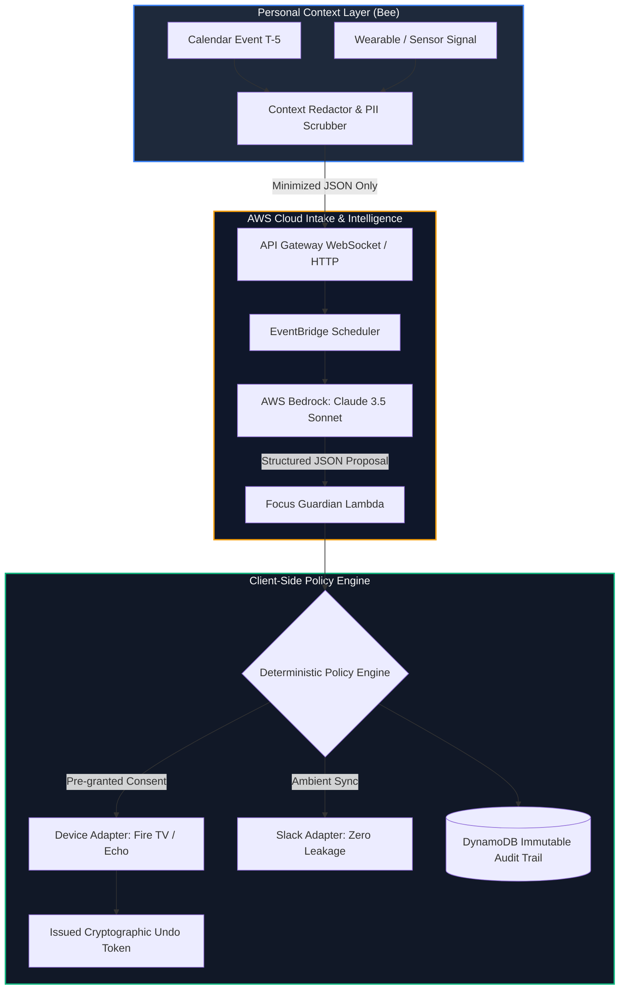

# Project AURA — Proactive Memory That Fights For Your Focus

<div align="center">

[](https://aws.amazon.com/bedrock/)
[](https://www.python.org/)
[](https://vercel.com/)
[](tests/)
[](LICENSE)
[](SECURITY_REVIEW_CERTIFICATION.md)

**Bee remembers what you forgot. Aura remembers what you're about to forget, and stops the world from distracting you.**

[🌐 Live Web Demo](#live-demo--interactive-control-plane) • [⚡ 3-Minute Presentation Script](#three-minute-demo-script) • [🏗️ Architecture](#system-architecture) • [🛡️ Zero-Surveillance Guarantee](#zero-surveillance-guarantee) • [🤖 IBM Bob Modernization](#ibm-bob-modernization)

</div>

---

## 🌟 Overview: What Makes AURA Different

Most meeting-memory products optimize the loop **record → transcribe → summarize after**.  
**AURA operates BEFORE the meeting**, then **acts through consented adapters** to defend your focus session.

Built as a privacy-first layer: Bee remains the local personal-memory source; AURA receives only purpose-bound, minimized context and never stores raw audio.

* **BEFORE not AFTER:** Calibrates context 5 minutes ahead of meetings ($T-5$) with evidence-grounded insights.
* **ACTS via Connected Devices:** Intelligently pauses allowed distractions (Fire TV, Echo DND) via verified capability paths.
* **100% Cryptographic Reversibility:** Every single action issued by the agent is bound to a 1-click **Undo Token**.
* **Zero-Surveillance Guarantee:** Strictly client-side minimization. Zero raw audio or unredacted transcripts ever touch the cloud. No employer leaderboards or surveillance.

---

## 🚀 Live Demo & Quickstart for Judges

### 1. Web Control Plane (Live on Vercel)
Launch the interactive mobile-first dashboard in your browser:
* Explore the **Landing Page** with architectural breakdowns.
* Open the **Control Plane** to trigger pre-meeting briefs, simulate focus distraction, execute reversible device pauses, and inspect the immutable audit log.

### 2. Interactive Terminal Live Demo (6-Stage E2E)
Run the automated end-to-end user journey in your terminal (with rich ANSI output):
```bash
python -m standalone_agent.live_demo --auto
```
*Stage 1: Pre-meeting brief → Stage 2: Distraction signal → Stage 3: Policy evaluation → Stage 4: Reversible pause + Undo → Stage 5: Zero-leakage Slack sync → Stage 6: Multi-provider resilience.*

### 3. Verify AWS Bedrock Integration
Verify your live AWS credentials, IAM STS identity, and Amazon Bedrock models:
```bash
python test_aws_bedrock.py
```

---

## 🏗️ System Architecture



Detailed architectural contracts, data models, and sequence flows are documented in:
* [`ARCHITECTURE.md`](ARCHITECTURE.md) — Comprehensive technical architecture
* [`PRD.md`](PRD.md) — Product requirements document & UX specification
* [`IMPLEMENTATION.md`](IMPLEMENTATION.md) — Module-by-module implementation plan
* [`RUNBOOKS.md`](RUNBOOKS.md) — Disaster recovery, circuit breakers, and operational runbooks

---

## 🛠️ Technology Stack

| Layer | Component | Description |
|---|---|---|
| **Personal Context** | Bee CLI / SSE / MCP | Local personal memory companion & PII scrubber |
| **Edge & Compute** | AWS API Gateway & Lambda | WebSocket relay & serverless focus guardian |
| **Intelligence** | Amazon Bedrock (Claude 3.5 Sonnet) | Structured output Converse API, prompt-injection defense |
| **Resilience** | Strands SDK Multi-Provider Gateway | Automated failover with sub-millisecond fallback |
| **Event Routing** | AWS EventBridge & SQS | T-5 event scheduling with DLQ retries |
| **State & Security** | AWS DynamoDB (TTL) + KMS | Single-table context cache with auto-expiry (30d) |
| **Client UI** | Vanilla ES6+ & Modern CSS | Zero-dependency, mobile-first Web Control Plane |
| **Integrations** | Alexa / Fire TV / Slack / Calendar | Reversible capability adapters via OAuth PKCE |

---

## ⏱️ Three-Minute Demo Script

* **0:00–0:20 — The Problem:** Show a calendar with a mentoring call and a focus block. *“Most note takers record after the meeting. AURA helps at the exact moment preparation matters.”*
* **0:20–0:55 — Consent & Privacy:** Open the Permissions tab. Show Bee context set to “local only / selected summaries,” pre-meeting cue enabled, and Fire TV action set to “ask every time.” Confirm raw audio is never sent to the cloud.
* **0:55–1:30 — Pre-Meeting Intelligence:** Trigger fixture meeting at T-5. Display glanceable briefing: concise context, tone analysis, three questions, and source evidence.
* **1:30–2:15 — The Focus Guardian:** Start a 25-minute focus session. Click “Simulate Distraction.” Review evidence and the proposed “Pause allowed Fire TV?” action. Approve it, then immediately click **Undo** to demonstrate full reversibility.
* **2:15–2:40 — Ambient Team Sync:** Toggle Slack status after previewing: “In focus until 14:30.” Confirm zero private meeting details or transcripts are posted.
* **2:40–3:00 — Cryptographic Proof:** Inspect the append-only audit trail showing policy grant, idempotency token, execution outcome, and instant revoke capability.

---

## 🛡️ Zero-Surveillance Guarantee

1. **Client-Side Minimization First:** Raw audio and private transcripts never leave the user's personal device.
2. **Ephemeral Context (TTL):** Cloud intake context expires automatically via DynamoDB TTL within 30 days.
3. **No Surveillance Metrics:** Strictly zero employee ranking, manager dashboards, or workplace productivity tracking.
4. **Deterministic Gatekeeper:** The LLM only proposes recommendations (`policy_required: true`); the standalone policy engine is the sole execution gate.

Detailed compliance, DPIA, and SBOM are certified in [`SECURITY_REVIEW_CERTIFICATION.md`](SECURITY_REVIEW_CERTIFICATION.md).

---

## 🤖 IBM Bob Modernization

> **Hackathon Track:** Theme 2 — Modernize What Matters (Experienced Developers)  
> Full submission details: [`MODERNIZATION_REPORT.md`](MODERNIZATION_REPORT.md)

IBM Bob's multi-file agentic capabilities were leveraged to modernize two production Lambda handlers, patch critical security gaps, and enforce contract-tested observability guarantees without regressions.

### What Was Modernized

| Handler | Improvements |
|---|---|
| [`lambda/websocket_handler.py`](lambda/websocket_handler.py) | Structured JSON logging (`_log`), strict token validation (empty/whitespace/short rejection, `Bearer` prefix normalization), query-string token warning, correlation IDs on all relay records, 32 KB payload cap, 5-item evidence bound. |
| [`lambda/focus_guardian.py`](lambda/focus_guardian.py) | Structured JSON logging, `fallback_reason` machine-readable tags on all `safe_fallback()` paths (`not_implemented`, `validation_error`, `hallucinated_evidence`), Pydantic input/output schemas, strict evidence hallucination guards. |

### Test Verification

```bash
# Run modernization contract test suite
pytest tests/contract/test_modernization_contract.py
```
* **10/10 Modernization Contract Tests Passing.**
* **Total test suite: 169 tests passing with 0 regressions.**

---

## ⚙️ Deployment & Setup

### Local Setup
1. Clone the repository and configure your environment:
   ```bash
   cp .env.example .env
   ```
2. Add your AWS Bedrock credentials in `.env`:
   ```ini
   AWS_ACCESS_KEY_ID=AKIA...
   AWS_SECRET_ACCESS_KEY=...
   AWS_REGION=us-east-1
   BEDROCK_MODEL_ID=anthropic.claude-3-5-sonnet-20241022-v2:0
   ```
3. Run verification test:
   ```bash
   python test_aws_bedrock.py
   ```

### Deploying the Web Control Plane to Vercel
The frontend web control plane is pre-configured with root and nested `vercel.json` configurations:
```bash
# Deploy directly with Vercel CLI
vercel --prod
```
Or import directly into the [Vercel Dashboard](https://vercel.com/new) with zero configuration needed.

---

## 📄 License

This project is licensed under the MIT License — see the [LICENSE](LICENSE) file for details.
