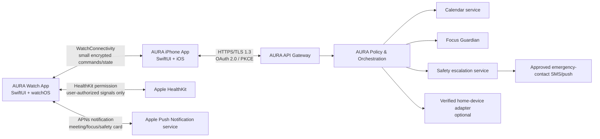
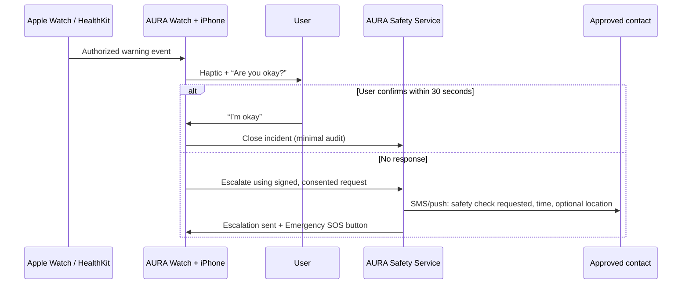

# AURA Apple Watch Implementation Plan

## 1. Purpose

This document defines how to implement **AURA as an independent Apple Watch application**. It does not depend on Bee hardware or the Bee application.

The Apple Watch app is a private, user-controlled companion for:

1. **Pre-meeting intelligence** — a short briefing five minutes before a selected meeting.
2. **Focus Guardian** — start/pause a focus session, report distraction, see a suggested response, and undo an action.
3. **Voice and preference controls** — the user opens AURA, dictates a thought/request, and controls what AURA may do.
4. **Optional Safety Guardian** — an opt-in check-in flow based on Apple-authorized HealthKit warning events. This is not a medical diagnosis feature.

## 2. Product promise and non-negotiable boundaries

### What AURA can promise

- AURA sends user-approved meeting and focus notifications to Apple Watch.
- AURA receives user actions such as **Start Focus**, **I'm distracted**, **Undo**, and **I'm OK**.
- AURA securely sends those actions through the companion iPhone app to the AURA backend.
- With explicit HealthKit authorization, AURA may react to supported Apple Watch health events and conduct a safety check-in.

### What AURA must not promise

- It does **not** continuously record conversations or listen in the background.
- It does **not** diagnose heart attack, cardiac arrest, or any medical condition.
- It does **not** replace emergency services, clinical monitoring, or Apple Emergency SOS.
- It does **not** automatically call emergency services from its own code. Apple Watch's built-in Emergency SOS and Fall Detection remain the appropriate system-level emergency calling mechanisms.
- It does **not** send health, meeting, focus-score, or private-memory details to Slack.

## 3. Recommended architecture



### Why a companion iPhone app is the recommended design

The Watch app is deliberately small, fast, and battery conscious. The iPhone app performs login, calendar connection, encrypted token storage, detailed settings, audit history, contact management, and most network work. The Watch communicates with its paired iPhone through Apple's **WatchConnectivity** framework.

The backend schedules the important action (for example, T-5 meeting preparation) and sends an Apple Push Notification. Do not depend on a watchOS background refresh to occur at an exact minute: watchOS may defer or throttle background work.

Apple resources:

- [WatchConnectivity](https://developer.apple.com/documentation/watchconnectivity)
- [Transferring data with WatchConnectivity](https://developer.apple.com/documentation/watchconnectivity/transferring-data-with-watch-connectivity)
- [watchOS notifications](https://developer.apple.com/documentation/watchos-apps/notifications)
- [watchOS background execution](https://developer.apple.com/documentation/watchkit/background-execution)

## 4. Apple Watch user experience

### 4.1 Watch home screen

Show only what is useful in one glance:

```text
┌─────────────────────────┐
│ AURA                    │
│ Next: Design Review     │
│ in 5 min                │
│                         │
│ [ View Prep ]           │
│ [ Start Focus ]         │
│ [ I'm distracted ]      │
└─────────────────────────┘
```

### 4.2 Pre-meeting notification

At five minutes before an eligible meeting, AURA sends a short notification:

```text
Design Review — starts in 5 min

Last decision: validate onboarding flow.
Tone: confident.

Ask:
1. What decision do we need today?
2. Who owns the next test?
3. What blocks release?

[Open] [Not useful] [Mute series]
```

Rules:

- Max 70 words of context; no raw transcript.
- Only use user-approved memory/calendar sources.
- Do not show sensitive data on the lock screen unless the user explicitly allows it.
- `Not useful` gives feedback; `Mute series` stops future reminders for that event series.

### 4.3 Focus Guardian screen

```text
Focus session: 24:18 remaining
Deep Work Bank: +12

[I'm distracted]
[End Focus]
```

When the user chooses **I'm distracted**, show an explanation and request approval:

```text
Focus check-in

You reported distraction.
Suggestion: pause allowed media device?

[Yes, once] [No] [Always ask]
```

The Watch only asks; the policy service decides whether a connected action is allowed. Unsupported actions always become a suggestion or a deep link, never a false success message.

### 4.4 Voice input

The user opens AURA and taps **Speak to AURA**. The app requests microphone/speech permission, displays an active recording state, converts the speech to text using an approved speech pipeline, and presents the transcript for confirmation before sending it.

Examples:

- “Start a 25-minute focus session.”
- “I am distracted.”
- “Remind me to ask about the release date.”
- “Change my meeting alert to 10 minutes.”

Never start microphone capture without this visible user action and permission.

### 4.5 Preferences and consent

Preferences belong primarily in the iPhone app because they require more screen space. The Watch includes a summary and a direct link to iPhone settings.

| Permission | Choices | Default |
|---|---|---|
| Meeting brief | Off / selected calendars / all selected meetings | Off |
| Watch notification preview | generic / private context | Generic |
| Focus actions | ask every time / this session / never | Ask every time |
| Slack status | off / selected channel with preview | Off |
| Safety Guardian | off / warning check-in + contacts | Off |
| Location in SOS | off / ask each time / approved contacts only | Ask each time |

## 5. Focus and meeting implementation

### 5.1 Event flow: T-5 meeting briefing

1. User connects a calendar in the iPhone app with OAuth and chooses eligible calendars.
2. AURA backend calculates T-5 for each selected event, respecting timezone, cancellation, edits, quiet hours, and user mute rules.
3. Backend builds a purpose-limited, redacted context envelope and asks the AURA agent for a structured briefing.
4. Policy service validates source permissions, data classification, and notification settings.
5. Backend sends an APNs notification to the iPhone/Watch app.
6. User selects an action on Watch; Watch sends the action to iPhone with `WCSession`; iPhone confirms it to the backend.
7. Backend records a privacy-safe audit entry and deletes transient context according to TTL.

### 5.2 Event flow: Focus Guardian

1. User taps **Start Focus** on Watch or iPhone.
2. Watch sends a `focus.started` command to the iPhone and displays countdown/points.
3. User taps **I'm distracted**; no hidden surveillance is required.
4. Backend returns a proposed response, such as `nudge`, `open_phone_focus_settings`, or `request_pause`.
5. The policy service verifies the grant, target device allowlist, time limit, and idempotency key.
6. AURA shows approval/Undo on Watch. Only an approved adapter executes a supported action.

### 5.3 Background behavior: the correct approach

| Need | Correct implementation | Do not do |
|---|---|---|
| Deliver briefing exactly near T-5 | Backend scheduler + APNs/local notification | Expect periodic watch background refresh to fire exactly at T-5. |
| Update complication/widget | Push / timeline update / occasional background refresh | Poll API continuously. |
| Update focus countdown | Local timer when active; reconcile with backend | Keep a permanent background process alive. |
| Receive user command | Visible Watch UI, complication, App Intent, or notification action | Listen continuously in background. |

Apple states that background refresh scheduling is best effort and can be deferred/throttled. [Background tasks documentation](https://developer.apple.com/documentation/watchkit/using-background-tasks)

## 6. Optional Safety Guardian — responsible implementation

### 6.1 Safety statement for the PRD and demo

Use this exact product language:

> “Safety Guardian is an opt-in check-in service. It can respond to Apple-authorized HealthKit warning events, such as a high/low heart-rate event, irregular-rhythm event, or fall-related event, and notify the user's approved contacts if the user does not respond. It is not a medical device, does not diagnose emergencies, and does not replace Emergency SOS or professional medical care.”

Never say: “AURA detects heart attacks,” “AURA detects heart stoppage,” or “AURA automatically calls an ambulance.”

### 6.2 Inputs

Subject to the user's HealthKit authorization and Apple/region availability, AURA may observe:

- high-heart-rate events;
- low-heart-rate events;
- irregular-heart-rhythm events;
- fall-related events;
- a user-initiated Safety Session, where live data is available during an active workout/safety session.

Apple documents immediate watchOS background delivery for several of these event types, including high/low heart-rate, irregular-heart-rhythm, and number-of-times-fallen events. This is not a guarantee that every physical incident is detected. [HealthKit background delivery](https://developer.apple.com/documentation/healthkit/hkhealthstore/enablebackgrounddelivery%28for%3Afrequency%3Awithcompletion%3A%29)

For a user-started active safety session, a properly configured `HKWorkoutSession` can keep the app running in the background and receive high-frequency heart-rate samples. It must remain clearly visible to the user as an active session, and it cannot claim clinical monitoring. [Running workout sessions](https://developer.apple.com/documentation/healthkit/running-workout-sessions)

### 6.3 Safety escalation flow



Recommended escalation rules:

1. A warning signal starts a **check-in**, not an automatic emergency declaration.
2. Watch delivers haptic feedback plus large controls: **I'm OK**, **Call Emergency**, **Notify Contacts**.
3. If the user does not respond after a user-configured interval (for example 30 seconds), send one message to pre-approved contacts.
4. Include location only when the user pre-approved location sharing for that contact; otherwise include time and a request to contact the user.
5. Rate-limit events, deduplicate retries, and provide a 60-second cancel window after contact escalation where safe.
6. The iPhone app shows a complete history and lets the user revoke contacts or disable Safety Guardian instantly.

### 6.4 Emergency calls

Do not build or claim a programmatic automatic emergency call. Direct the user to Apple Watch **Emergency SOS** and clearly label it as an Apple system function. Apple's own Heart Rate app can notify users about high/low heart rate and irregular rhythm, but readings can have anomalies and availability varies by region. [Apple heart-rate information](https://support.apple.com/en-us/120277)

## 7. Security, identity, and privacy

### 7.1 Account and device binding

1. User signs in on the iPhone via OAuth 2.0 Authorization Code Flow with PKCE.
2. iPhone creates a device key in Secure Enclave/Keychain where available and registers a public key with AURA.
3. User pairs the Watch through Apple’s normal pairing; the AURA Watch app is installed as the companion app.
4. Backend creates a `device_binding` with `user_id`, `iphone_device_id`, `watch_install_id`, key fingerprint, issued time, and status.
5. Only **one active AURA Watch binding per user** is allowed. A new binding revokes the old binding and sends a security notification.
6. Every Watch-originated request carries a short-lived signed session token, nonce, timestamp, and idempotency key.

### 7.2 Data transport

| Link | Protection |
|---|---|
| Watch ↔ paired iPhone | Apple WatchConnectivity transport; send only small commands and minimum state. |
| iPhone ↔ AURA API | HTTPS/TLS 1.3, OAuth access token, certificate/public-key binding, replay protection. |
| AURA services | IAM least privilege, KMS encryption, scoped service roles, Secrets Manager. |
| Emergency contact delivery | Server-side provider credentials in Secrets Manager; no contacts in client logs. |

### 7.3 Data minimization

- Store a focus state, action type, time, and outcome—not a complete personal activity timeline.
- Store a safety event as `event category + timestamp + delivery outcome`; do not store raw continuous health telemetry by default.
- Never send health data or meeting preparation content to Slack.
- Give the user export, delete, revoke, and emergency-contact removal controls.
- Redact sensitive content before any AI model invocation and do not place raw content in application logs.

## 8. Apple platform requirements

| Requirement | Why |
|---|---|
| Apple Developer Program account | Required to distribute a production App Store app and use APNs. |
| Mac + Xcode | Required to build/sign watchOS/iOS app targets. |
| iPhone + physical Apple Watch | Required for real WatchConnectivity, HealthKit background, notification, and sensor testing. Simulator is not enough for the safety flow. |
| Swift + SwiftUI | Recommended native Apple Watch UI stack. |
| WatchConnectivity | Securely transfers state/actions between paired Watch and iPhone. |
| UserNotifications + APNs | Delivers meeting, focus, and safety notifications. |
| HealthKit entitlement + purpose strings | Required before requesting health data. |
| HealthKit Background Delivery entitlement | Required for supported health-event updates while the app is not foregrounded. |
| Fall-detection entitlement (if applicable) | Review/request Apple entitlement and test only on supported physical devices. |

Use only Apple-approved capabilities. Do not attempt to bypass OS restrictions, scrape Apple Health data, or simulate medical certification claims.

## 9. Build plan

### Phase A — Watch UX prototype (hackathon)

- Build SwiftUI Watch screens with fixture data.
- Demonstrate pre-meeting card, focus countdown, distraction approval, Undo, preferences, and a simulated safety check-in.
- The demo must label simulated Fire TV/Echo actions as simulator actions unless real verified hardware is connected.

### Phase B — iPhone companion and backend integration

- Implement sign-in, device binding, calendar selection, focus policies, encrypted preference storage, and audit timeline.
- Add APNs with test/sandbox environment.
- Implement WatchConnectivity messages: `focus.start`, `focus.stop`, `distraction.reported`, `brief.feedback`, `sos.ok`, and `sos.escalate`.

### Phase C — HealthKit safety pilot

- Implement HealthKit consent screen and clear purpose strings.
- Start with Apple-authorized event observation; do not build medical inference on raw heart rate.
- Add a safety check-in and test contacts using synthetic/manual test events first.
- Conduct privacy, legal, clinical-safety, and App Review assessment before any external pilot.

### Phase D — production readiness

- Penetration test; threat model; DPIA/privacy review; accessibility testing; localizations; incident runbook; on-call monitoring; data retention/deletion tests; App Store review preparation.
- Test on real supported Apple Watch versions, with network loss, depleted battery, notification disabled, revoked HealthKit access, changed contacts, duplicated events, and contact delivery failure.

## 10. Test plan

### Functional

- [x] Meeting notification arrives near T-5 in user timezone.
- [x] `Open`, `Not useful`, and `Mute series` work from Watch.
- [x] Focus start/stop/distraction/Undo actions synchronize Watch, iPhone, and backend.
- [x] Duplicate button taps do not trigger duplicate backend/device commands.
- [x] Watch offline → action queues safely and reconciles once connected.

### Security and privacy

- [x] Only the signed-in user’s paired Watch can access AURA state.
- [x] A new Watch binding revokes the old one immediately.
- [x] Sensitive notification previews obey lock-screen privacy setting.
- [x] Health access can be revoked and stops new processing immediately.
- [x] Logs contain no raw health samples, meeting content, OAuth tokens, or contacts.

### Safety

- [x] Safety Guardian is off by default.
- [x] Alert clearly shows “not medical advice / not emergency detection.”
- [x] `I'm OK` stops escalation.
- [x] No-response escalation reaches only selected contacts and contains only approved fields.
- [x] Contact delivery failure shows an honest failure state; it never claims a message was sent when it was not.
- [x] Emergency SOS is a user-visible system handoff, not an AURA automatic call.

## 11. Judge demo explanation

> “AURA is an independent Apple Watch companion app. It uses Apple Push Notifications for timely meeting briefings, WatchConnectivity for secure command transfer through the paired iPhone, and explicit user consent for every action. The user can start focus, report distraction, give a voice request, or change preferences from their wrist. Safety Guardian is an optional check-in layer using Apple-authorized HealthKit warning events; it does not diagnose medical emergencies and never replaces Apple Emergency SOS.”

## 12. Official implementation resources

- [Apple: WatchConnectivity](https://developer.apple.com/documentation/watchconnectivity)
- [Apple: transferring data between Watch and iPhone](https://developer.apple.com/documentation/watchconnectivity/transferring-data-with-watch-connectivity)
- [Apple: notifications on watchOS](https://developer.apple.com/documentation/watchos-apps/notifications)
- [Apple: background execution](https://developer.apple.com/documentation/watchkit/background-execution)
- [Apple: background tasks and throttling](https://developer.apple.com/documentation/watchkit/using-background-tasks)
- [Apple: HealthKit background delivery](https://developer.apple.com/documentation/healthkit/hkhealthstore/enablebackgrounddelivery%28for%3Afrequency%3Awithcompletion%3A%29)
- [Apple: running workout sessions](https://developer.apple.com/documentation/healthkit/running-workout-sessions)
- [Apple: HealthKit access configuration](https://developer.apple.com/documentation/xcode/configuring-healthkit-access)
- [Apple Support: heart-rate notifications and limitations](https://support.apple.com/en-us/120277)

---

**Author / Architect:** Aditya Shinde  
*Project AURA · All Rights Reserved*
