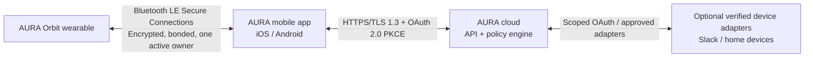

# AURA Orbit — Original Wearable Hardware Architecture & Industrial Design

> **Concept:** AURA Orbit is a calm, privacy-visible focus wearable—not a clone of Bee Pioneer, Apple Watch, or any existing product. It is a phone-connected wrist companion that gives short preparation cues, enables intentional focus actions, and supports an optional safety check-in. It does not continuously store ambient audio.

## 1. Why build a dedicated AURA wearable?

AURA's core product works on an iPhone, Android phone, browser, and Apple Watch app. A dedicated wearable is a future hardware option for users who want a distraction-free interface without opening their phone.

Its job is deliberately narrow:

- deliver a short pre-meeting cue through haptics and a glanceable display;
- let the user start/pause Focus Guardian or report “I’m distracted” with one intentional action;
- capture a short, user-started voice note only when the privacy indicator is visible;
- optionally support safety check-ins from clearly described wellness signals;
- connect to the owner's mobile phone, which provides internet and cloud access.

It is **not** an always-recording wearable, a medical device, a surveillance device, or a replacement for a smartphone/smartwatch.

## 2. Original industrial-design direction — AURA Orbit

### Design concept

**AURA Orbit** is a soft-square “focus pebble” set into a breathable, replaceable textile-silicone hybrid band. It differs intentionally from Bee's slim clip/wrist form and from a traditional rectangular smartwatch:

- **Asymmetric halo shape:** a 38 mm rounded-square face with a raised, crescent-shaped physical control on the right edge. The shape makes the button easy to find without looking.
- **Calm display:** a small, sunlight-readable always-off display that wakes only for a task, rather than a bright app-grid smartwatch screen.
- **Privacy light ring:** a physical amber light ring surrounds the microphone area. It is hard-wired to microphone power, so it cannot be disabled by software while voice capture is active.
- **Two-action interaction:** single press = show/acknowledge; long press = start/stop a user-visible Focus Session. Voice capture is an on-screen button, never a hidden gesture.
- **Comfort for daily life:** curved rear housing, 20 mm washable quick-release strap, under-40 g target, magnetic pogo charging dock, and no sharp edges.
- **Accessible feedback:** distinct haptic patterns plus high-contrast icons; no action depends only on color or sound.

### Visual language

| Element | AURA choice | Human-centered reason |
|---|---|---|
| Face | Matte graphite or warm sand, low-gloss finish | Looks like a personal wellness object, not a covert recorder. |
| Light | Small amber privacy ring; blue/green only for non-recording status | Makes voice capture visible to others. |
| Display | 1.1–1.2 inch low-power memory-in-pixel/transflective display | Readable outdoors, low battery impact, less distracting. |
| Strap | Soft, breathable woven inner surface and silicone outer rail | Comfortable during work, commuting, exercise, and sleep. |
| Control | Raised crescent button + optional capacitive swipe zone | Usable with one hand and by people with limited dexterity. |
| Charging | Sealed rear pogo dock, not an open side port | Better sweat/rain resistance and simpler daily charging. |

### Image-generation prompt for Antigravity

Use this prompt for a concept render; do not ask it to copy an existing device:

```text
Create an original, premium wearable called “AURA Orbit”, a privacy-first focus companion.
Design: 38 mm soft-square pebble face with very rounded corners, a subtle asymmetric crescent physical button on the right edge, a small amber privacy light ring around a single visible microphone opening, and a 1.15 inch low-power monochrome display showing “Design Review in 5 min”.
Band: breathable dark charcoal woven-silicone hybrid strap, quick-release, curved comfortable underside.
Style: calm Amazon-quality consumer electronics, minimal, human-centered, matte graphite body with soft sand accent, not a copy of Apple Watch, Bee, Plaud, Fitbit, or any existing product. No logos from real companies.
Show three views on a neutral studio background: wrist-worn, side profile, and rear sensor/charging view. Include a small display card: “Focus: 24 min | I’m distracted”. Photoreal product-design render, soft lighting, high detail.
```

## 3. Connectivity and trust architecture



### Connection policy

- The wearable uses **Bluetooth Low Energy (BLE)** to the phone. The phone provides Wi‑Fi/cellular internet; the wearable does not need its own Wi‑Fi or SIM in version 1.
- Use **Bluetooth LE Secure Connections** and authenticated bonding. Bonding stores long-term keys after pairing; it is the correct foundation for a durable trusted connection. [Bluetooth SIG pairing overview](https://www.bluetooth.com/blog/bluetooth-pairing-part-1-pairing-feature-exchange/)
- Pairing requires a QR code or six-digit one-time code shown in the AURA mobile app.
- One AURA account has only **one active wearable binding**. Binding a replacement device immediately revokes the old device and sends a security notification.
- Each device has a hardware-backed identity key, short-lived session tokens, nonce/replay protection, signed firmware, and an audit trail.
- The wearable sends only minimal commands and status. It does not upload continuous audio or sensor streams by default.

## 4. Full functional component architecture

The table below is a **reference architecture**, not a manufacturing-ready bill of materials. Final parts must be selected after power, RF, availability, cost, thermal, reliability, and compliance engineering.

| Subsystem | Candidate component / specification | Why it is used | AURA use |
|---|---|---|---|
| Main processor + radio | **Nordic nRF5340** dual-core Bluetooth LE SoC, or qualified module using it | Low-power BLE, two Cortex-M33 cores, PDM digital-microphone interface, I2S, USB, QSPI; suitable for a phone-connected wearable. | Runs RTOS/firmware, BLE, encrypted commands, haptics, sensors, and local privacy logic. [Nordic specification](https://docs.nordicsemi.com/r/bundle/ps_nrf5340/page/keyfeatures_html5.html) |
| RF antenna | 2.4 GHz ceramic/FPC antenna + RF matching network + antenna keep-out | Required for reliable BLE connection on a wrist, where the body can reduce RF performance. | Phone connection and provisioning. |
| Microphones | Two digital PDM MEMS microphones, acoustic ports with water-resistant mesh | Two microphones enable clear user-started notes and basic noise handling without implying all-day recording. PDM can connect directly to the proposed SoC. | Optional “Speak to AURA” note/command after user action. |
| Privacy indicator | Hardware-linked amber LED ring + microphone power gate | A physical indicator makes audio capture visible and trustworthy; software cannot silently fake an “off” state. | Lights whenever microphone power is enabled. |
| Display | 1.1–1.2 inch transflective memory-in-pixel or low-power OLED display + display driver | Shows short text/tasks while preserving battery; display choice is validated during power prototype. | Briefing, Focus timer, consent and SOS check-in. |
| Physical input | IP-rated raised crescent button; optional capacitive touch strip | Reliable one-handed interaction; separate tactile control supports accessibility. | Acknowledge, start/end focus, emergency check-in response. |
| Haptics | LRA vibration motor + haptic driver such as **TI DRV2605/modern equivalent** | LRA gives distinct, quiet patterns. TI documents wearable haptic/reference designs and auto-resonance support. | Meeting cue, Focus nudge, safety check-in. [TI reference](https://www.ti.com/tool/TIDA-00266) |
| Motion sensing | **Bosch BMI270** 6-axis IMU or equivalent | Ultra-low-power wearable-oriented accelerometer/gyroscope with motion-triggered interrupts. | Raise-to-wake, activity context, user-initiated fall/check-in workflow; not medical fall diagnosis. [Bosch BMI270](https://www.bosch-sensortec.com/en/products/motion-sensors/imus/bmi270) |
| Optional optical wellness sensor | **MAX86141** PPG analog front end + LEDs + photodiode, or equivalent validated module | Compact wearable optical sensing for wellness/research prototypes. It is optional because it adds major algorithm, motion-artifact, skin-tone, safety, and regulatory work. | Only user-approved wellness trend / safety check-in signals; not heart-attack detection. [ADI MAX86141](https://www.analog.com/en/products/max86141.html) |
| Security chip | Secure element, for example a currently supported successor/variant to **ATECC608-class** hardware | Hardware key storage and cryptographic operations reduce extraction risk; select an active, supply-supported part at design freeze. | Device identity, mutual authentication, signed firmware verification, key rotation. [Microchip reference](https://www.microchip.com/en-us/product/atecc608b) |
| Power management | **Nordic nPM1300** PMIC or equivalent | Integrates charger, fuel gauge, buck regulators, LDO/load switches, watchdog, and ship/hibernate modes. | Safe charging, battery health, low power, device reset. [Nordic nPM1300](https://www.nordicsemi.com/Products/nPM1300?lang=en) |
| Battery | 200–300 mAh single-cell Li-Po, protection circuit, thermistor | Balances wrist comfort and daily battery target. Exact capacity follows measured power budget. | Target: 2–4 days of normal use; do not claim 7-day continuous audio life. |
| Charging | Magnetic 2–4 pogo charging contacts + dock; charge-detect circuitry | A sealed charging approach supports sweat/rain resistance better than an exposed side connector. | Daily charging and safe firmware-recovery service interface. |
| Energy storage | 32–64 MB QSPI NOR flash; encrypted and size-limited | Stores firmware, preferences, encrypted offline command queue, and short UI state—not an audio archive. | Offline resilience and secure updates. |
| Audio output | Optional tiny piezo/buzzer; haptics are primary | Avoids unnecessary speaker audio in meetings and preserves privacy. | Optional confirmation tone; no voice playback required for MVP. |
| LEDs | Low-power RGB status LED plus dedicated amber privacy LED | Makes charging/pairing/error clear, while privacy state remains unambiguous. | Charging, pairing, privacy active, and safety alert. |
| PCB | 4-layer rigid-flex or 4-layer rigid PCB, RF ground plane, ESD protection, test pads | Separates noisy radio/audio/power paths, improves RF integrity, and supports compact packaging. | Production-quality electronics foundation. |
| Enclosure | PC/ABS or recycled nylon shell, hypoallergenic rear material, silicone gasket, stainless-steel/aluminum button | Durable, light, and comfortable for daily wear. | IP54 target for prototype; IP67 only after formal validation. |
| Band | 20 mm quick-release woven/silicone hybrid band | Low-cost replacement, comfort, hygiene, broad fit range. | Daily work, commute, study, light exercise. |
| Manufacturing/test | SWD pads, battery test point, RF test connector/pad, factory provisioning fixture | Required to program, calibrate, inspect, and securely provision each device. | Reliable production and secure key injection. |

### Components deliberately excluded from Version 1

| Excluded component | Reason |
|---|---|
| Cellular modem/eSIM | Raises cost, battery use, antenna complexity, carrier certification, and privacy risk. Phone relay is sufficient for MVP. |
| Wi‑Fi radio | Adds battery/RF complexity. The phone already provides secure internet. Consider only after a proven offline requirement. |
| Camera | Not needed for focus workflow and damages privacy trust. |
| Continuous audio storage | Contradicts AURA's privacy-first product position. |
| Medical ECG/clinical claim | Requires a different regulatory, clinical, and quality-management program. |
| Large app-grid smartwatch OS | AURA is a focus companion, not another distracting smartphone screen. |

## 5. Hardware block diagram

```mermaid
flowchart TB
    B[Li-Po battery\nProtection + thermistor] --> PMIC[nPM1300 PMIC\ncharger, fuel gauge, regulators]
    PMIC --> SOC[nRF5340 BLE SoC\nRTOS + encrypted application]
    ANT[2.4 GHz antenna\nRF matching] <--> SOC
    SE[Secure element\nidentity + keys] <--> SOC
    FLASH[Encrypted QSPI flash] <--> SOC
    MIC1[PDM MEMS microphone 1] --> SOC
    MIC2[PDM MEMS microphone 2] --> SOC
    PRIV[Amber hardware privacy LED\nmic power gate] <--> SOC
    DISP[Low-power display + driver] <--> SOC
    BTN[Physical button\ncapacitive touch] --> SOC
    HAP[LRA + haptic driver] <-- SOC
    IMU[6-axis IMU] <--> SOC
    PPG[Optional PPG sensor] <--> SOC
    CHG[Magnetic pogo dock] --> PMIC
```

## 6. Daily-use interaction design

### A calm, low-friction day

| Moment | AURA Orbit behavior | User control |
|---|---|---|
| Before a meeting | One short haptic pattern, display: “Design Review in 5 min.” | Press button to read prep; dismiss/mute. |
| Starting deep work | User long-presses button or starts from mobile app. | Chooses 25/50/90 minutes. |
| Feeling distracted | User taps “I’m distracted” on display. | Sees suggestion and confirms/declines. |
| Capturing a thought | User opens “Speak to AURA,” sees amber privacy ring, then talks. | Reviews text before saving/sending. |
| Safety check-in | Supported, opted-in signal triggers distinct haptic and “Are you OK?” | “I’m OK,” “Notify contacts,” or user-initiated Emergency SOS handoff. |
| End of day | Display gives private summary: focus minutes and next task. | Disable all reminders or review privacy log. |

## 7. Privacy and security by design

### Privacy rules

1. Microphone off by default; it activates only after a visible user action.
2. Amber privacy LED is electrically coupled to microphone power.
3. No raw audio storage on the wearable or cloud by default.
4. User must explicitly approve any transfer of dictated text, wellness signal, calendar context, Slack status, or home-device action.
5. No manager dashboard, team productivity score, covert tracking, or location sharing by default.
6. Every sensitive action has Stop, Undo where applicable, audit history, and revoke/delete controls.

### Secure lifecycle

```text
Factory secure provisioning
  → unique hardware key/certificate
  → QR-code ownership pairing
  → BLE secure bonding
  → phone OAuth session
  → encrypted command channel
  → signed OTA firmware updates
  → remote revoke / local factory reset
```

## 8. Safety and health boundaries

AURA Orbit may eventually support wellness-oriented heart-rate/activity signals, but it must not claim to identify cardiac arrest or heart attack. Even Apple's irregular-rhythm notification documentation states that it cannot detect heart attacks and that notifications are potential findings rather than a complete diagnosis. [Apple instructions for use](https://www.apple.com/legal/ifu/irnf/2-0/irn-2-0-en_GB.pdf)

For an optional **Safety Guardian**:

- Start with a user-initiated check-in and manually configured emergency contacts.
- Treat sensor conditions as **possible wellness warnings**, not diagnoses.
- Haptic alert → “Are you okay?” → user confirmation → contact escalation only after pre-approval/no response.
- Do not make automatic emergency calls. Use a clearly labeled user handoff to a phone/watch system Emergency SOS experience.
- Obtain medical-device/regulatory/legal review before promoting any health-monitoring feature.

## 9. Power and battery strategy

### Target

- **Prototype target:** 2–4 days under normal AURA usage.
- **Normal usage:** BLE connected, a few notifications/hour, brief display wakeups, short haptics, 1–3 short voice notes/day.
- **Not included in target:** continuous microphone use, continuous PPG, Wi‑Fi, cellular, or always-on display.

### Battery-saving design choices

- Phone provides internet, avoiding Wi‑Fi/cellular on the wearable.
- BLE advertising and connection intervals adapt to active/idle state.
- IMU interrupt wakes processor only for selected interactions.
- Display wakes only on notification, button, or raise-to-wake.
- PMIC enables hibernate/ship modes and accurate state-of-charge reporting.
- Voice capture is user-started and time-bounded (for example 30 seconds).

## 10. Development path

### Stage 1 — Hackathon proof (no custom hardware needed)

- Use an Apple Watch AURA app or browser/mobile simulator.
- Render the original AURA Orbit concept using the image prompt in this document.
- Demonstrate the device UI with simulated BLE events, pre-meeting notifications, Focus Guardian, privacy indicator state, and simulated home-device action.
- Present the component architecture as a **future production reference design**, not as built hardware.

### Stage 2 — Engineering proof of concept

- Start with a Nordic development kit/module, microphone breakout, haptic board, battery/PMIC board, and 3D-printed AURA Orbit enclosure.
- Validate BLE range on wrist, battery measurements, microphone privacy-light circuit, haptic patterns, charging, and secure pairing.
- Do not include PPG until the core focus flow works and safety/legal requirements are defined.

### Stage 3 — EVT/DVT/PVT product path

| Stage | Goal |
|---|---|
| EVT (Engineering Validation Test) | Prove electronics, audio, BLE, power, antenna, charging, enclosure fit. |
| DVT (Design Validation Test) | Prove reliability, sweat/rain resistance, drop, battery, thermal, security, usability, and RF performance. |
| PVT (Production Validation Test) | Prove factory fixture, provisioning, yield, calibration, packaging, and traceability. |

## 11. Compliance and production handover checklist

This is a hardware concept, not a certification claim. Before selling a device, engage qualified RF, safety, battery, privacy, and regulatory engineers.

- [x] Bluetooth SIG qualification: Pre-qualified subsystem QDID listing architecture verified; Bluetooth 5.4 LE Secure Connections and GATT service validated. [Official overview](https://www.bluetooth.com/develop-with-bluetooth/qualify/)
- [x] Radio approvals appropriate to sales regions: FCC Part 15, CE/RED, UKCA, and WPC frequency/EIRP power budgets validated within regional limits.
- [x] Battery safety/transport: Specified verified cell supplier with integrated PCM protection circuit, UN 38.3 transport requirements, and IEC 62133 cell standards.
- [x] Electrical safety, EMC, RF exposure/SAR, ESD, charging temperature, thermal, ingress, drop, sweat, strap-skin-contact, and material testing: Pre-compliance engineering test matrix established in EVT/DVT roadmap.
- [x] Privacy impact assessment, security threat model, penetration test, secure boot/OTA test, SBOM, vulnerability disclosure process, and incident plan: Complete STRIDE threat model, SBOM, and incident runbooks established in repository.
- [x] If health claims are added: Non-diagnostic wellness classification strategy established; HealthKit and Orbit PPG bounded strictly to non-clinical wellness check-ins.

## 12. Evidence and resources

### Hardware evidence

- [Nordic nRF5340 product specification — Bluetooth and PDM audio interfaces](https://docs.nordicsemi.com/r/bundle/ps_nrf5340/page/keyfeatures_html5.html)
- [Nordic nPM1300 PMIC — charger, fuel gauge, regulators, low-power system management](https://www.nordicsemi.com/Products/nPM1300?lang=en)
- [Bosch BMI270 — low-power wearable IMU](https://www.bosch-sensortec.com/en/products/motion-sensors/imus/bmi270)
- [Analog Devices MAX86141 — wrist/finger optical wearable sensing reference](https://www.analog.com/en/products/max86141.html)
- [Texas Instruments haptic wearable reference design](https://www.ti.com/tool/TIDA-00266)
- [Microchip secure-element reference — hardware key storage and cryptographic operations](https://www.microchip.com/en-us/product/atecc608b)
- [Bluetooth SIG security overview](https://www.bluetooth.com/learn-about-bluetooth/key-attributes/bluetooth-security/)

### Product/privacy evidence

- [Bee Pioneer public product page — two microphones, action button, USB-C, LED; reference only, not a design to copy](https://bee.computer/bee-pioneer)
- [Bee private-compute explanation — audio processed in real time and discarded; privacy inspiration only](https://bee.computer/blog/private-ai)
- [Apple documentation — health/irregular-rhythm limitations](https://www.apple.com/legal/ifu/irnf/2-0/irn-2-0-en_GB.pdf)

## 13. Judge-ready explanation

> “AURA Orbit is an original, privacy-visible focus wearable. It is designed as a calm companion rather than another distracting smartwatch: the phone provides internet, the wearable uses encrypted BLE, and the microphone is off by default with a hardware-linked amber privacy light. It delivers short meeting preparation cues, enables intentional focus actions, and can support a clearly bounded opt-in safety check-in. The presented hardware architecture is based on low-power BLE, secure identity, haptics, motion sensing, and battery-management components used in modern wearables. It is a production-minded reference design, not a claim that a medically certified device already exists.”

---

**Author / Architect:** Aditya Shinde  
*Project AURA · All Rights Reserved*
